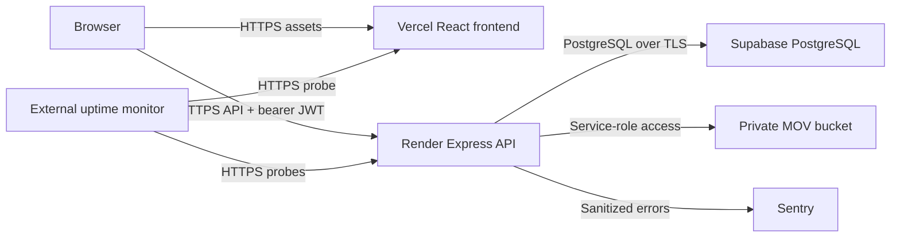

# Phase 3: operator deployment guide (issue #28)

This kit prepares **Vercel frontend + Render API + Supabase PostgreSQL and private Storage**. You create the accounts, configure credentials, choose plans, and deploy. No resource is provisioned by checking in these files. Phase 3 remains pending until the live checks and recovery drill below pass.

## 1. Files and architecture

| File | Purpose |
| --- | --- |
| `frontend/vercel.json` | Vite build, SPA deep links, browser headers, manual deployments |
| `render.yaml` | One persistent Node API instance, readiness check, environment prompts |
| `backend/.env.production.example` | Backend production variable reference |
| `frontend/.env.production.example` | Public frontend build-time variable reference |
| `docs/PHASE_3_EVIDENCE.md` | Checklist to complete and attach to issue #28 |



The browser calls Render directly; Vercel is not an API proxy. Keep one API instance initially: the rate limiter is process-local. Multiple instances need shared rate-limit storage and further qualification. Files belong in Supabase Storage, never Render's local filesystem.

Authentication, report downloads, and the shared API client now use the same `VITE_API_BASE_URL` through `frontend/src/api/apiUrl.ts`; leaving it blank preserves same-origin `/api` behavior for local development.

## 2. Prepare accounts and release

1. Grant Vercel and Render access to this private repository. Create separate production and staging Supabase projects. Record project IDs and regions; select compatible nearby regions, subject to your data residency requirements.
2. Review the paid Render compute choice in `render.yaml` before importing it. Select a Supabase plan with the backup retention/PITR coverage you require. Verify actual entitlements in the account; this repository does not enable backups.
3. Reserve a frontend hostname and API hostname (provider HTTPS subdomains work). Create a Sentry Node project and select an external uptime/alert service with a named operator and backup contact.
4. Use Node 22 and the checked-in package locks. From the repository root, run each command and stop on failure:

   ```powershell
   npm --prefix backend ci --include=dev
   npm --prefix frontend ci --include=dev
   Push-Location backend
   npx prisma generate
   Pop-Location
   npm --prefix backend run typecheck
   npm --prefix backend test
   npm --prefix frontend run typecheck
   npm --prefix frontend test
   npm --prefix frontend run build
   npm --prefix backend run test:qualification
   ```

   The qualification runner requires PostgreSQL tools; set `PG_BIN` to their bin directory if needed. It uses an isolated synthetic database, not production.
5. Require passing frontend, backend and database qualification checks for the exact release commit. Record its SHA. Do not run fixture/qualification scripts with production credentials.

## 3. Database: prepare before deploying the API

Use [manual deployment](../backend/docs/manual-deployment.md) for existing deployment details. The Prisma schema describes the current application, while `backend/supabase/migrations/` also contains historical SQL. There is **no Prisma migration history** to deploy: `npm run db:migrate` is not the production migration procedure.

### Existing database

1. Take a verified backup and rehearse changes against an isolated restored copy.
2. Compare installed SQL migration history and actual tables with the repository. Apply only reviewed, missing SQL files in timestamp order using the Supabase SQL editor or `psql -X -v ON_ERROR_STOP=1 -f <file>`. Do not replay already applied files; some deliberately are not idempotent.
3. Compare the resulting schema with `backend/prisma/schema.prisma`; review any differences before generating/applying a corrective SQL migration. Do not run `prisma db push`, `migrate reset`, or `--accept-data-loss` against an existing production database.

### Brand-new empty application database

1. Disable the project's Data API during provisioning, and leave the application offline. Confirm that no application data or tables already exist.
2. Rehearse the repository's database CI procedure on staging: apply the SQL files in `backend/supabase/migrations/` in filename/timestamp order. Supabase already supplies `anon`, `authenticated`, and `service_role`; do not recreate them. Stop immediately on a SQL error.
3. Historical SQL and the current Prisma model may differ. From `backend/`, with `DIRECT_URL` supplied securely in the shell and pointing to **staging**, generate a reviewable reconciliation file:

   ```powershell
   npx prisma migrate diff --from-url "$env:DIRECT_URL" --to-schema-datamodel prisma/schema.prisma --script --output schema-reconciliation.local.sql
   if ($LASTEXITCODE -ne 0) { throw 'Schema comparison failed' }
   ```

   Inspect all proposed drops, type changes, and constraints. Preserve SQL-only check constraints and RLS policies. Save the approved reconciliation as a versioned SQL migration, apply it on staging, then generate the diff again to confirm no remaining Prisma differences. If the diff proposes dropping unrelated Supabase/legacy objects, resolve scope first; do not execute it blindly.
4. Once rehearsed, apply the same ordered SQL and reviewed reconciliation to the new production project. Re-run `20260914141827_deny_tagad_data_api_access.sql` after reconciliation to cover any newly created `tagad_` tables; that hardening file is designed to be repeatable. Record exactly which files and checksums were applied. SQL editor/psql execution does not automatically maintain Supabase CLI migration history, so maintain the release ledger and reconcile it before ever using CLI `db push`.

For either path, use the role/RLS queries in the manual deployment guide. Verify geography and feedback SQL check constraints remain present. Confirm `anon` and `authenticated` cannot read canonical `tagad_` tables and the backend PostgreSQL account can perform intended operations. Prisma uses a trusted database login that can access RLS-protected tables; the service-role HTTP key is a separate credential. Prefer a dedicated backend role scoped to application tables; keep schema-owner credentials for operator migrations. Do not grant frontend clients access to these tables.

Keep the Data API disabled if unused; Storage is accessed through its own API. Do not re-enable it without verifying grants and RLS. See [Supabase Prisma connections](https://supabase.com/docs/guides/database/prisma) for connection options; this repository uses Prisma 5, so retain its existing datasource syntax.

### Connection strings and initial accounts

- Copy credentials from Supabase **Connect**. For the persistent Render process, a session pooler connection on port 5432 is a practical IPv4 option. Direct connections require reachable networking. Use TLS (`sslmode=require`) and URL-encode the password. Set a modest Prisma `connection_limit` within your project's connection budget.
- Set `DATABASE_URL` for runtime. Set `DIRECT_URL` to a direct/session connection for administrative tooling, never a transaction-mode pooler. Both can use session mode for this setup. PostgreSQL backup tools need a libpq-compatible connection string without Prisma-specific `schema` or `connection_limit` parameters.
- In a restricted one-time operator process from `backend/`, set `DATABASE_URL`, `DIRECT_URL`, `ADMIN_PASSWORD`, and `SUPER_ADMIN_PASSWORD`, then run `npx prisma generate` and `npm run db:seed`. This creates `admin@talibon.gov.ph` and `superadmin@talibon.gov.ph` plus reference data. Review placeholder office head/barangay captain names before launch. Remove seed passwords from the shell afterward; do not add them to the hosted API.
- The seed updates existing accounts' role/profile fields and does not reset existing password hashes. Do not use it as a routine deployment or password-reset step.

## 4. Private file storage

Create `mov-attachments` in Supabase Storage with **Public disabled**. Set its size limit to 20 MiB (20,971,520 bytes), consistent with `MOVAttachmentService.ts`. If setting a MIME allowlist, copy all supported types from that service (images, PDF, Word, Excel, MP4, QuickTime).

Set `SUPABASE_URL`, `SUPABASE_SERVICE_ROLE_KEY`, and `SUPABASE_MOV_BUCKET` on Render. The service key must belong to the same project as the database and bucket. The API authorizes uploads and issues temporary download URLs; no broad browser upload/read policies are needed. Review any existing Storage policies that might grant access across buckets. [Supabase Storage access control](https://supabase.com/docs/guides/storage/security/access-control) documents service-key access.

In staging and after deployment, upload a synthetic file through the app, download it with the authorized account, verify an out-of-office account is denied, and verify an unsigned public URL cannot retrieve it. Test signed URL expiry. Capture evidence without copying tokens or signed URLs into the issue.

## 5. Backend deployment on Render

1. Import the repository as a Blueprint using root `render.yaml`. Review the region/paid plan and branch before creating it. Initial creation can start a build even though later automatic deployments are disabled.
2. Fill the prompted variables using `backend/.env.production.example` as reference. Render generates separate JWT secrets. Keep them stable across releases; rotating them invalidates sessions. For manual generation, run `node -e "console.log(require('node:crypto').randomBytes(32).toString('hex'))"` twice in a private terminal and save outputs directly in the secret store.
3. Set `CORS_ORIGINS` to the exact frontend HTTPS origin(s), comma-separated. No wildcard, `/api`, or URL paths. Do not add arbitrary preview origins to production; use a separate staging API/database for previews.
4. Start with `TRUST_PROXY=false` until you verify the ingress contract in section 7. Set `SENTRY_DSN` and `SENTRY_RELEASE` (release commit SHA). Do not enable demo mode or disable database probes.
5. The build retains dev dependencies because the production entrypoint needs `tsx`. `npm run build` only checks TypeScript; there is no compiled `dist` server. The start command is **`npm start` from `backend/`**, not the root package's start command. Render supplies `PORT` and the server binds to `0.0.0.0`.
6. Use **Manual Deploy** for the reviewed commit. Require `GET /api/ready` to return HTTP 200 with `{"status":"ready"}` before proceeding. `/api/health` alone does not establish DB readiness. Save the API HTTPS hostname.

This Blueprint contains no migration or seed hook. Database preparation is a separate operator release step. See [Render Blueprint fields](https://render.com/docs/blueprint-spec) and [health checks](https://render.com/docs/health-checks).

## 6. Frontend deployment on Vercel

1. Import the repository, set **Root Directory = `frontend`**, framework Vite, Node 22. The checked-in `frontend/vercel.json` supplies installation/build/output settings and SPA routing. It disables automatic Git deployments; import/CLI deployments are operator actions.
2. In **Production** environment variables, set `VITE_API_BASE_URL=https://YOUR-API.onrender.com/api`. Replace with your actual API hostname. Leave optional browser Supabase variables blank for Express JWT authentication. `VITE_SUPABASE_ANON_KEY` is the name the code reads, not `VITE_SUPABASE_KEY`.
3. Deploy manually from the reviewed checkout: from `frontend/`, run `npx vercel link`, then `npx vercel --prod`. Inspect the linked project before deploying. Alternatively use the dashboard's initial import/deployment flow.
4. Verify both `/` and a direct visit/refresh to `/login` and an authenticated deep link. The [Vercel SPA rewrite](https://vercel.com/docs/frameworks/frontend/vite) serves `index.html` for client routes. API requests must go to Render and return JSON, not the frontend HTML fallback.
5. If using a custom frontend hostname, update Render's CORS origins and redeploy the API configuration. Vite variables are compiled into assets: changing the API URL requires a **frontend rebuild**, not just a dashboard variable edit.

Never put database URLs, JWT secrets, service-role keys, seed passwords, or Gemini keys in Vercel frontend variables. Every `VITE_*` value is public. For local preview builds only, copy the frontend template to `.env.production.local`. The backend's dotenv loader normally reads `.env`; it does not automatically read `.env.production`. Production hosts should inject variables directly. Keep real `.env` files out of Git and do not overwrite existing local files while following this guide.

## 7. HTTPS, CORS, and trusted proxies

Configure custom domains through each provider and follow their displayed DNS records. Wait for a valid certificate before switching users. Verify both hostnames serve HTTPS, HTTP redirects to HTTPS, and the browser has no mixed-content requests. Monitor certificate expiry; adding a domain alone does not prove TLS readiness.

From PowerShell, replace the hostnames:

```powershell
curl.exe -i https://YOUR-API.onrender.com/api/health
curl.exe -i https://YOUR-API.onrender.com/api/ready
curl.exe -i -X OPTIONS https://YOUR-API.onrender.com/api/auth/login -H "Origin: https://YOUR-FRONTEND.vercel.app" -H "Access-Control-Request-Method: POST" -H "Access-Control-Request-Headers: authorization,content-type"
curl.exe -i -X OPTIONS https://YOUR-API.onrender.com/api/auth/login -H "Origin: https://untrusted.invalid" -H "Access-Control-Request-Method: POST"
```

The allowed preflight should return the exact allowed origin and methods/headers. The untrusted origin must receive no `Access-Control-Allow-Origin` permission; a non-2xx response is expected. Current code also allows localhost origins in production and permits requests without an Origin header; CORS does not replace JWT authorization or network controls. Include that behavior in the operator review.

Record `client -> provider edge -> Node`, the actual socket peer, header append/replace behavior, and every alternate ingress path (including provider default domain and any added CDN). Use [proxy-topology.md](../backend/docs/proxy-topology.md). Choose trusted CIDRs where supported; a numeric hop count is appropriate only after verifying every ingress route has the same trust boundary. Do not infer `1` merely from the provider name. `true` is rejected by the app.

Use two client networks and a deliberately forged `X-Forwarded-For` on staging, correlate request IDs with access/audit logs, and confirm the derived IP is the real client and rate limiting cannot be bypassed by changing the header. Keeping `false` groups clients by proxy IP and may cause shared login throttling; resolving this is a launch gate.

## 8. Automated backups, retention, and restore test

Follow [backup-and-recovery.md](../backend/docs/backup-and-recovery.md). Its prior project status is historical, not a current service check.

1. In the production Supabase project, confirm scheduled database backups are active, record the latest successful timestamp and actual retention. Enable PITR if the chosen recovery target requires it; record the available recovery window. Select a plan/coverage that meets your approved target. Proposed minimum: **RPO 24 hours, RTO 4 hours**, to be measured in a drill.
2. Configure a daily operator-managed backup job outside the app host: a restricted scheduler with compatible PostgreSQL tools, read access to the full application database, and encrypted off-project storage. Use `pg_dump --format=custom --no-owner --no-acl`, check exit status, list the archive with `pg_restore --list`, calculate SHA-256, encrypt, then upload. Supply credentials from that scheduler's secret store. Do not store dumps as public CI artifacts or in this repository. The linked recovery guide includes PowerShell commands.
3. Configure a separate scheduled export of **MOV file bytes**, paths, MIME types, sizes and SHA-256 checksums to the protected backup destination. Use a Storage-aware export tool/job with pagination and failure checking; a database dump or copy of `storage.objects` is insufficient. Select and test the export tooling before closing Phase 3. Coordinate DB/object capture during a write pause for drills, or document and reconcile the time gap.
4. Set retention/lifecycle rules for **7 daily + 4 weekly encrypted copies** of both DB and MOV exports, with separate daily/weekly prefixes or equivalent tagging. Keep encryption keys recoverable outside the production project. Verify expiration on test objects and ensure today's failure cannot delete the last valid copy.
5. Send a success heartbeat only after dump, object export, verification, encryption and upload all succeed. Alert on failure or no successful completion within 26 hours. Test a deliberately failed staging job and confirm the operator receives it. A scheduler that exists but has no successful backups does not pass.
6. Restore an actual recent backup into a **separate isolated project/database** with different hostname/project ID and no outbound integrations. Verify the archive checksum first; use `pg_restore --exit-on-error --no-owner --no-acl`. Restore objects to a private drill bucket and reapply reviewed grants/RLS. Follow Supabase's provider restore procedure for platform-managed schemas rather than blindly overwriting `auth`/`storage` in another project.
7. Compare per-table counts and content fingerprints with a snapshot captured at backup time, validate foreign keys, object counts/checksums and attachment references, then run login, role/office denial, token revocation, exports and MOV download tests against the restored environment. Measure restore duration and actual recovery point. Repeat quarterly and after material schema/storage changes.

[Supabase database backups](https://supabase.com/docs/guides/platform/backups) do not include Storage object bytes. Neither the deployment templates nor the synthetic CI restore drill establish production backup coverage. The scheduled off-project and object jobs above are operator configuration work still to complete.

## 9. Monitoring and operational alerts

Configure these rules in your selected monitoring tools; the application does not consume an invented monitoring JSON file. Set recipients, escalation after 15 minutes without acknowledgement, and recovery notifications. Test delivery to both primary and backup contacts.

| Area | Configure | Initial alert rule |
| --- | --- | --- |
| Frontend availability | External HTTPS GET `/` and `/login`, check expected HTML | Every 60s; 3 consecutive failures |
| API liveness | External GET `/api/health`, HTTP 200 and `status=ok` | Every 60s; 3 failures |
| API/database readiness | External GET `/api/ready`, HTTP 200 and `status=ready` | Every 60s; 3 failures |
| API application | Render CPU/memory/restarts and structured HTTP logs | Memory >80% for 10m; repeated restarts; 5xx >2% with >=20 requests/5m |
| Latency | Log `durationMs` for API requests, exclude health probes | p95 >2s for 10m; tune after baseline |
| Database | Supabase metrics/logs: connections, CPU, disk, slow queries | Connections/disk >80% of allocation; sustained CPU >80% for 10m |
| Errors | Existing backend Sentry integration | New production error and sustained recurrence |
| Recovery | Backup success heartbeat and drill evidence | Missing success >26h; any failed drill |
| TLS | External certificate checks on both hosts | Certificate expires in <14 days |

Readiness uses a periodic DB connectivity probe plus revocation hydration, so outages may take a probe interval to appear; it does not test Storage, query performance, or all tables. Use provider DB metrics in addition. Configure the necessary paid metrics/log export capability if your provider plan does not expose alert rules. Restrict log access and select a documented retention period (initial proposal: 30 days); logs can contain user IDs and network metadata.

Use [error-tracking.md](../backend/docs/error-tracking.md) for Sentry. To verify real delivery without adding a public crash route, run a one-off staging process from `backend/` with staging `SENTRY_DSN`, `SENTRY_RELEASE`, and `NODE_ENV=staging` in its environment:

```powershell
node --import tsx --input-type=module -e "const m=await import('./server/lib/errorTracking.ts'); await m.initializeErrorTracking(); m.captureBackendError(new Error('synthetic staging delivery check'),500); const s=await import('@sentry/node'); if(!await s.flush(5000)) process.exit(1);"
```

Confirm the sanitized event's release and alert delivery in Sentry. A successful flush without a configured DSN is not proof of delivery. Current backend tracing is disabled and there is no browser error SDK: Sentry here covers backend errors only. If browser exception tracking is required, that needs a separate reviewed integration.

## 10. Launch, rollback, and closing issue #28

Perform authenticated smoke checks in the real deployed app: valid/invalid login, logout and revoked-token denial, office isolation, create/update a synthetic record, >500-row CSV/XLSX export, public data view, and authorized/unauthorized MOV access. Confirm no database credentials or service-role keys appear in frontend assets/network requests. Use authorized synthetic records and clean them up through supported app flows.

Record commit, migration ledger, URLs, TLS/CORS/proxy results, backup job IDs and successful executions, measured restore evidence, alert tests, and responsible contacts in [PHASE_3_EVIDENCE.md](PHASE_3_EVIDENCE.md). Store sensitive details in your restricted operations record and link a redacted summary from #28.

For an application regression, manually redeploy the previous known-good API commit and the matching frontend build (with the correct production API URL). Keep schema changes backward compatible across the rollback window. Do not reverse SQL migrations blindly. For a data incident, stop writes, follow the recovery runbook, validate the isolated restore, rotate both JWT signing secrets to reject sessions whose revocations may have been lost, then switch connections and resume after smoke checks.

Close Phase 3 only when all evidence items pass. Checked-in configuration means **deployment preparation is complete**, not that production services, backups, restores, or alerts have been verified.
