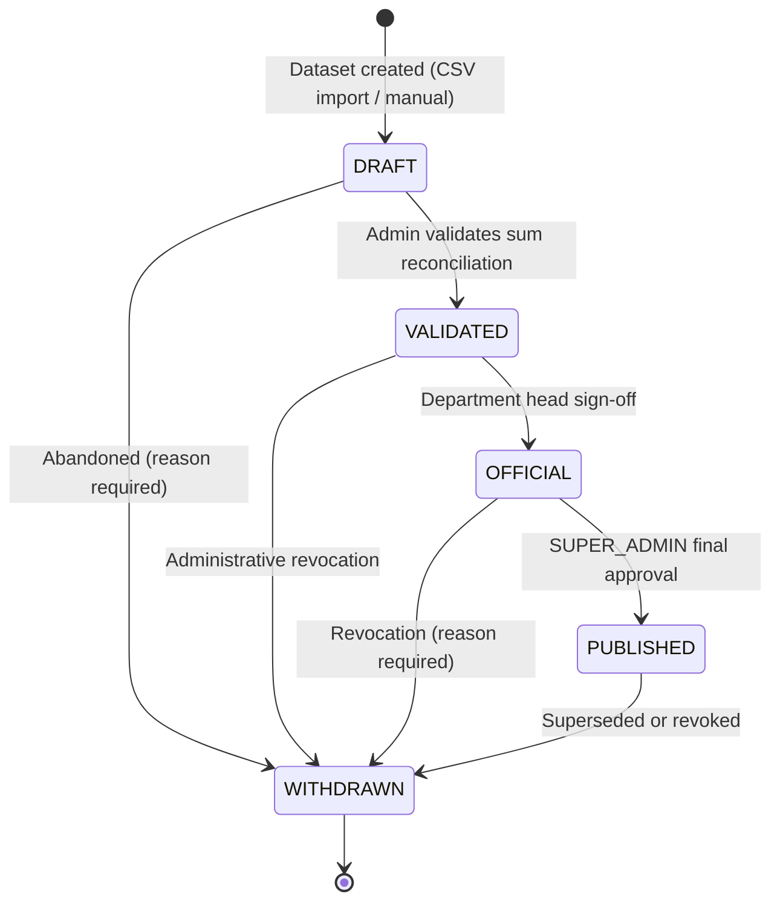

# TAGAD Statistical Dataset Governance Module
**System:** Talibon Analytics for Gender and Development (TAGAD)
**Module:** Statistical Dataset Governance
**Version:** `v2.1.0`
**Status:** `IMPLEMENTED & VERIFIED — Sprints 7/13/15`
**Legal Standards:** Data Privacy Act of 2012 (RA 10173), Magna Carta of Women (RA 9710), PSA CBMS Governance Framework

---

## 1. Purpose

The Statistical Dataset Governance module enforces a strict five-stage publication lifecycle for all statistical data entering TAGAD. Every dataset begins as a `DRAFT` and can only reach `PUBLISHED` through a sequential approval chain. This prevents unverified, preliminary, or revoked data from appearing on public-facing dashboards or exports.

---

## 2. Publication Lifecycle State Machine

```
DRAFT → VALIDATED → OFFICIAL → PUBLISHED
  ↓           ↓           ↓          ↓
           WITHDRAWN ←──────────────────
```

Full mermaid diagram:



### State Transition Authority Matrix

| From | To | Permitted Roles | Precondition | API Endpoint |
|---|---|---|---|---|
| `[NONE]` | `DRAFT` | ENCODER, ADMIN, SUPER_ADMIN | Valid metadata, unique datasetCode | `POST /api/admin/datasets` |
| `DRAFT` | `VALIDATED` | ADMIN, SUPER_ADMIN | Schema conformity pass | `POST /api/admin/datasets/:id/validate` |
| `VALIDATED` | `OFFICIAL` | ADMIN, SUPER_ADMIN | Department endorsement | `POST /api/admin/datasets/:id/official` |
| `OFFICIAL` | `PUBLISHED` | SUPER_ADMIN only | Executive authority | `POST /api/admin/datasets/:id/publish` |
| Any except WITHDRAWN | `WITHDRAWN` | ADMIN, SUPER_ADMIN | Non-empty revocation reason | `POST /api/admin/datasets/:id/withdraw` |

### Invariant Rules (enforced by `StatisticalDatasetService.canTransition()`)

1. **No forward skip:** `DRAFT` cannot jump directly to `OFFICIAL` or `PUBLISHED`.
2. **No backward regression:** `VALIDATED` or `OFFICIAL` cannot revert to `DRAFT`.
3. **Terminal lock:** `WITHDRAWN` is terminal — no further transitions.
4. **Identity rejection:** Transitioning to the same current state throws `ValidationError`.
5. **SUPER_ADMIN exclusivity on PUBLISHED:** Only `SUPER_ADMIN` may call the publish endpoint.

---

## 3. Default Status Enforcement (GOV-1)

Every new dataset is created with `publicationStatus = DRAFT` regardless of what the caller passes:

```typescript
// StatisticalCatalogService.createDataset — enforced default
const dataset = await prisma.statisticalDataset.create({
  data: {
    ...params,
    publicationStatus: StatisticalPublicationStatus.DRAFT, // always DRAFT
  },
});
```

Any attempt to create a dataset with `publicationStatus: 'OFFICIAL'` or any other non-DRAFT value is rejected with a `ValidationError` before the database write.

---

## 4. Table Structure Lock on OFFICIAL Datasets (GOV-2)

Once any dataset using a given statistical table definition reaches `OFFICIAL` status, the table's dimension bindings become immutable. Calling `TableBuilderService.unbindDimension()` on a table that has an `OFFICIAL` dataset throws `ForbiddenError`:

```typescript
// TableBuilderService.unbindDimension
const officialDatasets = await prisma.statisticalDataset.findFirst({
  where: {
    tableDefinitionId: table.id,
    publicationStatus: { in: ['OFFICIAL', 'PUBLISHED'] },
  },
});
if (officialDatasets) {
  throw new ForbiddenError('Cannot remove dimension binding from a table with OFFICIAL or PUBLISHED datasets.');
}
```

This prevents structural schema drift from invalidating observation coordinates that are already part of an approved dataset.

---

## 5. Dataset Visibility Rules

| Publication Status | Public API (`/api/public/*`) | Admin API (`/api/admin/*`) |
|---|---|---|
| `DRAFT` | Hidden | Visible to ENCODER (own office), ADMIN, SUPER_ADMIN |
| `VALIDATED` | Hidden | Visible to ADMIN, SUPER_ADMIN |
| `OFFICIAL` | Hidden | Visible to ADMIN, SUPER_ADMIN |
| `PUBLISHED` | Visible | Visible to all authenticated users |
| `WITHDRAWN` | Hidden | Visible to ADMIN, SUPER_ADMIN (read-only audit) |

---

## 6. Real Data vs. Placeholder Badge (GOV-3)

`TableBuilderService.listTables()` injects two computed fields on every table entry:

| Field | Type | Logic |
|---|---|---|
| `hasRealData` | `boolean` | `true` if `verificationStatus === 'VERIFIED'` |
| `dataStatus` | `string` | `"REAL DATA"` if verified, otherwise `"UNVERIFIED"` |

These fields drive the data quality indicator shown in the statistical catalog browser UI (when built) and are available via `GET /api/admin/table-builder/tables`.

---

## 7. Privacy & PII Safeguards

- **Zero citizen PII in statistical layer:** `StatisticalObservation` stores only aggregated numeric values and categorical dimension tags (JSON). No citizen names, contact details, or addresses exist in the statistical schema.
- **Public API shield:** All public-facing endpoints query only `publicationStatus = 'PUBLISHED'` datasets. Draft and official datasets are structurally isolated.
- **Small-cell suppression:** Observations with small cell counts are flagged with `suppressionStatus = "SMALL_CELL_SUPPRESSED"` to prevent deductive disclosure in low-population barangays. The suppression threshold is configurable per LGU/PSA guidance (default: n < 3).

---

## 8. Provenance & Audit Immutability

Every state transition executes inside a `prisma.$transaction` block that atomically writes:
1. The new `publicationStatus` on `StatisticalDataset`
2. A `StatisticalProvenance` record (source agency, file name, methodology notes)
3. An `AuditLog` entry with `beforeState` and `afterState` snapshots

SHA-256 checksums of uploaded source files are recorded in `StatisticalProvenance.checksum`.

Audit history is retrievable via `GET /api/admin/datasets/:id/history`.

---

## 9. Observation Grid Export (GRID-5)

Authenticated users may export all observations for a given table+dataset:

```
GET /api/admin/table-builder/tables/:id/observations/export
  ?datasetId=<uuid>
  &format=csv         (default)
  &format=xlsx
```

- **CSV:** RFC-compliant comma-separated format, UTF-8, with proper quoting for commas and embedded quotes.
- **Excel (xlsx):** Styled header row (blue), columns: Period, Barangay, Indicator Code, Numeric Value, Unit, Dimensions (JSON), Suppression Status, ID.
- Returns full dataset with no pagination (capped at 10,000 rows per request).
- Requires authentication (any role may read PUBLISHED data; DRAFT/OFFICIAL data requires ADMIN or higher).

---

## 10. Office Scope Enforcement

- **ENCODER:** Can create datasets only for their assigned office. Cannot view unapproved drafts from other offices.
- **ADMIN:** Cross-office operational access. Can validate and officialize datasets.
- **SUPER_ADMIN:** System-wide authority. Only role that can publish datasets to public visibility.

---

## 11. Test Coverage Summary

All governance rules are covered by the backend test suite (180/180 passing as of Sprint 15):

| Test Suite | File | Coverage |
|---|---|---|
| Dataset governance state machine | `datasetGovernance.test.ts` | All 5 states, 13 transition cases, RBAC |
| Governance tie-in spec | `statisticalGovernanceIssue17.test.ts` | GOV-1 DRAFT default, GOV-2 dimension lock, GOV-3 fields |
| Observation CRUD & bulk | `statisticalDataEntryGrid.test.ts` | GRID-1, GRID-2 dimension validation |
| Statistical CSV import | `statisticalCsvImport.test.ts` | SIMP-1–4, discover/preview/execute |
| Table builder HTTP | `tableBuilderHttpIntegration.test.ts` | CMS-2/3/4 full dimension/indicator lifecycle |

---

## 12. Key Service Files

| Concern | Service / File |
|---|---|
| Dataset lifecycle | `backend/server/services/StatisticalDatasetService.ts` |
| Dataset CRUD API | `backend/server/routes/admin/datasets.ts` |
| Table structure & dimensions | `backend/server/services/TableBuilderService.ts` |
| Table API | `backend/server/routes/admin/tableBuilder.ts` |
| Observation CRUD & bulk | `backend/server/services/ObservationService.ts` |
| Observation export (GRID-5) | `backend/server/controllers/admin/observationController.ts` |
| CSV import pipeline | `backend/server/services/StatisticalObservationIngestionService.ts` |
| Import API | `backend/server/routes/admin/statisticalImport.ts` |
| 69-table catalog | `backend/server/services/StatisticalCatalogService.ts` |
