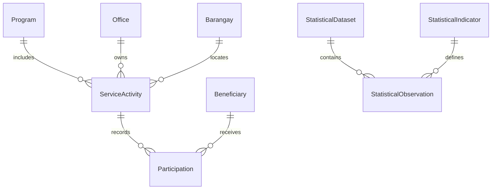

# Data model and migration plan

Design only; no schema, migration, data or environment change is authorized by this audit. Evidence: E02/E05–E07/E10–E15 in [VERIFICATION_BASELINE.md](VERIFICATION_BASELINE.md). Resolve D02–D09 before dependent models are finalized.

## Current model and proposed additive changes

| Current structure / limitation | Proposed adjustment | Preservation and acceptance |
| --- | --- | --- |
| `User.role`, optional office/barangay; four roles | Capability assignments with scope and persona mapping; explicit ownership independently of account affiliation | Keep UUIDs and existing sessions/accounts under compatibility policy; migration never grants broader access by inference. Missing assignments denied and reviewed. |
| `Beneficiary.sex` binary; age integer plus optional birthdate | Approved category dictionary and explicit unknown state; separate sex/gender fields only if necessary and approved; dated age/age-band definition | Preserve original MALE/FEMALE values. Never translate missing into female, zero age or an inferred birthdate. Category expansion must update all totals/imports/exports together. |
| Single free-text sector, no beneficiary type | Controlled sector/type references; optional many-to-many membership if D03 requires overlap | Keep original text and mapping provenance. Ambiguous values enter reconciliation queue; no silent merging. |
| `Program` and `GADPlanItem`, no service occurrence | Proposed `ServiceActivity` linked to program/PAP where applicable, office, occurrence date/range, location/barangay and approved service type | Retain plan items and all historical activities represented as text; do not invent dated events from fiscal year/quarter. |
| Beneficiaries unlinked to services; sex counts in program/accomplishment | Proposed `Participation` references authorized beneficiary and service activity, with source and counting semantics; approved aggregate path remains separate | Define repeat-attendance/unique-person key with D04. Do not manufacture persons or participation from aggregate counts. Preserve original totals as legacy reported measures. |
| `StatisticalDataset` ownership inferred through `importedBy.officeId` | Explicit owning office/barangay scope, source class, reporting period and dataset version | Current importer office may have changed; confirm backfill against source/audit, quarantine unresolved ownership rather than granting broad access. |
| Generic `StatisticalIndicator`, `StatisticalDimension`, `TableDimensionBinding` | Reuse for approved GAD dictionary with code/version, grain, units, denominator, allowed categories, sensitivity and form mapping | Existing catalog IDs/numbers preserved. Approved GAD subset is a view/configuration, not deletion of CBMS catalog. |
| `StatisticalObservation.numericValue` required; JSON dimensions and hash, no declared unique grain constraint | Explicit observation status for missing/suppressed/invalid versus numeric zero; canonical dimensional grain and deduplication key after profiling | Do not insert zero for missing data. Nullable value/status or a companion status model must be decided in WP04. Detect duplicates before adding uniqueness; hash includes all grain-defining fields, with defined null handling. |
| Nullable barangay boundary/point/source/verified fields | Source/version/license/checksum and verification record; stable official-code mapping/aliases | Keep original geometries and UUIDs; coordinate conversion must be documented, reversible and tested. No invented boundaries or codes. |
| GPB/GAR and accomplishment counters; mutable records | Report snapshot/template version plus source references and generation filters; correction lineage | Do not overwrite prior official outputs; distinguish reported historical total from newly calculated participation. |
| Audit JSON before/after, MOV storage paths | Controlled audit field allowlists and scope; attachment classification/retention metadata where approved | Preserve audit and object identifiers; no bulk personal-data copying to logs or uncontrolled export archive. |
| Household and old SQLite artifact | No expansion needed for proposal; retain pending dependency/retention review | No deletion, import or person matching from `dev.db` in this task. Household linkage remains optional and purpose-limited. |

Proposed relationship shape (names are design placeholders, not existing tables):

Aggregate observations remain distinct from participation. No automatic relationship equates a survey population count with GAD beneficiaries. Confidential service fields are not approved until D05 is resolved; an aggregate-only path may satisfy reporting without storing case details.

## Migration baseline risks

1. SQL migrations and Prisma are parallel schema authorities in practice. `RevokedToken` appears in Prisma, while the checked-in SQL does not create its table. Database CI uses `db push` after SQL replay; successful CI alone cannot establish migration completeness. Inventory every table, enum, constraint and grant in WP03.
2. Canonical and statistical SQL includes objects/constraints not necessarily represented in Prisma. Preserve database constraints/RLS when reconciling; never replace SQL with a destructive schema push.
3. Existing cascades include program-to-accomplishment and dataset-to-observation relationships. Any retirement or migration that deletes a parent risks losing historical results. This plan uses additive changes and archival review only.
4. Scope backfill, sector normalization, age history and person deduplication cannot safely be derived from labels/current account assignments alone. A mapping needs source evidence and unresolved-row handling.
5. Statistical amounts/counts/rates and Decimal precision must retain units and grain. Summing rates or floating-point money would corrupt reporting. Counts must be nonnegative integers where the approved indicator defines them as counts; other indicators need their own ranges.

## Staged execution for later authorized packages

1. **Inventory and baseline (WP03).** In an isolated environment, replay checked-in SQL without `db push`; compare to intended Prisma schema and approved deployment inventory. Record migration ledger, schema fingerprints, constraints, grants, row counts and object references. Reproduce both fresh install and upgrade. Missing DDL must receive an additive reviewed migration.
2. **Snapshot and restore rehearsal.** Obtain an authorized, access-controlled database and storage backup; use synthetic or approved de-identified staging data. Prove restoration, including MOV paths/objects and security state, before a production migration is considered. Record RPO/RTO as measured against D10, not assumed.
3. **Expand (WP04).** Add nullable columns/reference tables/new relationships and deny-default policies. Do not remove old fields, enum values or IDs. Deploy compatible reads/writes only after migrations are present; enforce new requirements gradually as backfill permits.
4. **Map and backfill.** Version source-to-target mappings and batch checkpoints. Use deterministic keys and idempotent batches with per-batch audit/reconciliation. Preserve originals; quarantine unresolved codes, category ambiguity, unknown dates and unmatched ownership. No guessed person links or generated statistical values.
5. **Reconcile.** Compare row counts, foreign keys, checksums, demographic totals by source/period/sex/barangay/office, financial Decimal totals and attachment references. Check suppressed/missing counts independently. Investigate every difference; approved semantic corrections must be documented, not hidden in tolerances.
6. **Switch reads (WP05–12).** Shadow-query old/new views on the same authorized fixtures; compare outputs and scope. Enable one module/cohort at a time. Ensure older clients cannot bypass new permissions and that changed categories are not forced into binary summaries.
7. **Observe and retain.** Monitor rejected writes, data quality and query performance. Keep prior columns, snapshots and migration mappings through an LGU-approved compatibility/retention window. A later contract phase is separate work requiring dependency and retention approval; no automatic drops are planned.

## Rollback

Application rollback must remain compatible with additive schema changes. Use feature gating/route compatibility to stop new writes and restore the previous verified reader; do not roll back to a known disclosure or validation defect. Retain any data entered under the new model in protected storage with a reconciliation plan. Once new categories or participation have been recorded, an old binary-only client is not automatically safe: restrict it or keep a compatibility adapter.

For failed backfill, resume/reverse only the affected idempotent batch using recorded mappings and prior values. Do not truncate tables or run down migrations that discard new data. Database restoration is a last-resort authorized operational procedure after impact/lost-write analysis, not the default rollback. JWT/session state and object storage may have a different recovery point; reconcile and revalidate before reopening access.

Release evidence must include fresh/upgrade schema replay, no unexplained drift, complete reconciliations, all-persona scope tests, representative report equality, measured query plans at agreed scale, restoration evidence, and LGU acceptance of unresolved-data handling.
