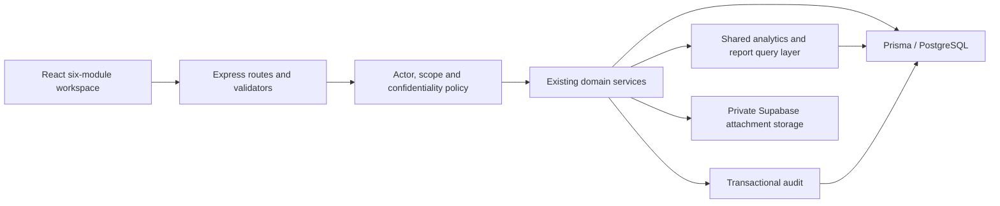

# Target architecture

Proposed design for I/IV/V, subject to [OPEN_DECISIONS.md](OPEN_DECISIONS.md). Reuse the existing stack and modular monolith; no new service platform or comprehensive CBMS subsystem is justified. This document specifies future changes only.

## Six-module information architecture

| Module | User-facing workspace | Existing implementation to reuse |
| --- | --- | --- |
| User Management | Accounts, persona/capability assignments, office/barangay scope, access review | `UserManagement.tsx`, auth modules, UserService/AuthService (E03) |
| Data Encoding | Approved GAD forms; beneficiaries when necessary; aggregate indicator entry; import preview and correction queue | `DataEncoding.tsx`, ingestion wizard, data grid and dictionaries (E05/E07) |
| Program and Service Monitoring | Programs/PAPs, service activities, participation/results, plan items and accomplishments | `ProgramMonitoring.tsx`, `GADPlan.tsx`, `Accomplishments.tsx` (E06) |
| Dashboard and Analytics | Shared filters, sex/age/sector/program comparisons, data quality/freshness; barangay view with map/table | Dashboard/PublicDemographics and GeoJSON (E08/E10) |
| Report Generation | Template catalog, parameters, preview, export history; GPB/GAR/sector/barangay/M&E/planning | Reports and export services (E09) |
| Data Security and Privacy | Authorized administration: audit/access review, data classification/release settings, operational status | Audit/MOV services and operational docs (E11/E13) |

Security remains cross-cutting rather than a screen that enables protection. Show navigation by capability while enforcing the same permission on the API. Place statistical authoring under Data Encoding/configuration; hide technical table/dimension terminology from routine encoders where an approved form suffices. Preserve route aliases through a tested compatibility period; resolve duplicate catalog routing without removing access unexpectedly. Public portal remains a separate audience, subject to D05/D09.

## Backend boundaries

Keep thin controllers; both legacy and admin routes call the same validators and service policy. Identity owns sessions and assignments; reference/dictionary services own office/barangay/indicator metadata; encoding owns record validation/import/corrections; monitoring owns activity/participation and plan/accomplishment transitions; analytics owns authorized aggregate queries; reporting owns templates, snapshots and output rendering. Audit, data classification and availability handling are shared services.

Actor context is mandatory for internal reads and writes, including aggregates, exports, attachments and background jobs. Public services receive an explicit public policy, not a missing actor interpreted as unrestricted access. Intersect requested filters with authorized scope; do not rely on UI filters or request-supplied office/barangay IDs. Database errors return an unavailable state in production, not plausible empty or demo totals.

## Proposed role and scope model

Preserve existing account IDs and four legacy role values during transition. Add explicit capability assignments with scope; persona labels are bundles, not immediate enum renames. D02 must settle multiple assignments and office/barangay intersections before WP05. Proposed defaults for review:

| Proposal persona | Capabilities | Scope / limits |
| --- | --- | --- |
| System Administrator | Provision users/configure system, review security operations | Administrative authority does not automatically disclose confidential case detail; privileged access separately justified and audited. |
| GAD Focal Person | Review GAD datasets/monitoring, analyze, prepare reports | Assigned offices/barangays or approved municipal aggregate; approval delegation subject to D09. |
| Department Encoder | Enter/correct draft records and upload permitted evidence | Assigned office plus permitted geographic coverage; no release or user administration. |
| Barangay Encoder | Enter/correct assigned barangay submissions | Barangay and approved program/office context; no cross-barangay browse or export. |
| Viewer | Read authorized approved summaries | No mutation or automatic person-level access. |
| Report Generator | Preview/export approved templates and scopes | No implied edit, publish or confidential-detail capability. |

Default deny for missing assignments and unresolved owners. Test all role/scope combinations against detail IDs, list filters, search, totals, exports and aliases. Remove technical SUPER_ADMIN bypass from confidential domain access only through an approved migration policy; maintain emergency operational access as a separately audited decision, not an invented LGU rule.

## Data collection and validation

Use two explicit data grains: individual service participation when necessary and authorized, and aggregate observations from approved sources. A beneficiary registry is not the municipal population, attendance is not unique people, and imported census/CBMS observations are not automatically service outcomes. Each dataset/indicator records grain, population, period, unit, method, source and owner. Never sum incompatible grains or mix published/unverified versions.

Workflow: select approved form/source → classify data and authorized scope → upload/encode → normalize stable codes and approved vocabularies → preview field/row errors and possible duplicates → confirm valid submission → transactionally persist source/batch and records with audit → review/validate → release only if permitted. Reuse both ingestion engines but share dictionary, scope and validation logic. Confirm mappings explicitly; do not turn arbitrary CSV headers into official indicators. Strict mode is the proposed default; any partial import must enumerate rejected rows and make retries idempotent.

Record age at agreed reference/activity date or an explicitly dated age observation; do not infer birthdates. Preserve additional applicable categories, unknown/refused/missing states according to D03 without conflating sex and gender identity. Replace UI-only sector/beneficiary-type assumptions with approved definitions. Correct records through auditable versions or events; preserve earlier report snapshots.

## Analytics and S01 barangay mapping

Shared query contract: metric/indicator, dataset/version, period, sex/category, age-band version, barangay, sector, office, program/service and authorized audience. Return counts or rates with denominators, units, source, freshness, coverage and status. Differentiate zero, missing, suppressed and unavailable. Serve the same result to charts, maps and reports to avoid inconsistent totals. Fetch on save/filter/refresh initially; “real time” needs D11 freshness/latency targets and does not require WebSockets by default.

Retain Barangay IDs and existing nullable geometry fields. D07 must supply an authoritative or LGU-approved boundary dataset, licensing/attribution, date, coordinate system and code mapping. Validate Polygon/MultiPolygon topology, coordinate order, coverage of the 25-barangay roster, island geometries, duplicates and unmatched records; retain source/version/checksum and reviewer. Points are points, not substitute boundaries. Never interpolate a boundary or location for an unlocated barangay.

Proposed client: focused GeoJSON renderer with pan/zoom, keyboard-selectable barangay, legend, male/female comparison, synchronized accessible table and explicit missing/suppressed state. Select a mapping library only during authorized WP10 after size, licensing and accessibility evaluation; no dependency is added by this audit. Join metrics by stable barangay key, not label; prevent totals from revealing suppressed cells. Without approved geometry show a clearly labeled table/unlocated list and report the map requirement as blocked, not completed. Public map publication is a separate D05/D07 decision.

## Reporting and privacy

Reuse ExcelJS/PDFKit and statistical export primitives. Workflow: select versioned approved template → choose scope/period/filters → authorize → compute common query/snapshot → preview completeness and warnings → export → audit recipient scope, actor, source versions and generation time. Page through the complete result set; enforce limits deliberately rather than silently exporting the first page. GPB/GAR templates require LGU-provided examples and applicable references (D06); do not claim official formatting or fill absent outcomes with plausible text. Freeze reproducible snapshots for accepted reports without freezing future corrections.

Minimize personal collection; distinguish restricted individual records, internal aggregates and approved public aggregates. WCPD/VAWC/health data needs approved fields and purpose, restricted capabilities, non-identifying logs, controlled attachments and release rules before collection. No general case-management expansion is proposed. Key stripping is defense-in-depth; use response allowlists and approved statistical suppression, including complementary/differencing protection across filters and downloads. No numeric threshold, retention period, lawful basis or legal compliance is invented here.

## Operations and audit

Reuse readiness, revocation, rate limiting, error tracking and audit mechanisms. Establish mutation plus audit atomicity, authorized sensitive read/export logging, tamper-resistant operational handling, backups covering database and MOV storage, restore validation and account/session recovery. Review new-table grants/RLS explicitly: Express authorization remains necessary even with Supabase Data API denied. Track data-quality errors, import failures, stale submissions, report counts, readiness and restore failures using privacy-safe telemetry. D10/D11 define ownership, recovery objectives, support and load targets; WP13 verifies target deployment rather than accepting historical documentation as proof.
